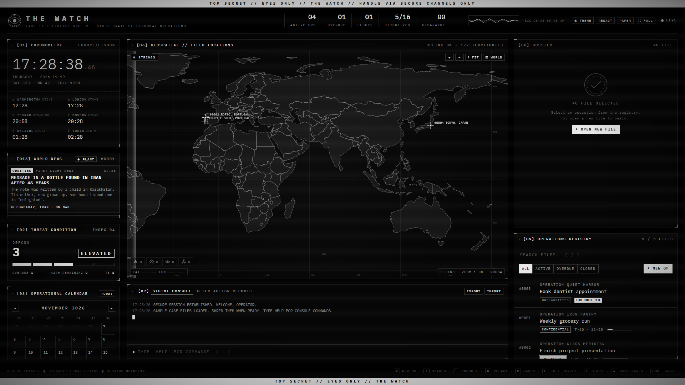

# The Watch

A gamified task planner styled as a Cold War intelligence terminal. Each task is a classified "operation" with a codename, a deadline, a checklist and a pin on a world map. Finishing work earns clearance, which you spend on animated missions on that map.

It is a single-page, offline-first web app written in vanilla JavaScript, with no framework, backend or build step.



## Features

**Planning**
- Operations (tasks) with a classification level, a deadline, notes, a checklist and an optional map location
- Weekly recurring operations that reopen on their chosen days
- An operations registry with search and filters (All / Active / Overdue / Closed)
- A month calendar showing deadlines and recurring days
- A focus timer (25 minutes by default) linked to the selected operation, with an audio alarm

**Game layer**
- **Clearance:** closing an operation earns +1, paid once per operation, so reopening a task can't be farmed
- **Threat condition:** a live index driven by overdue work, deadlines inside 24 hours and Top Secret operations, mapped to five levels
- **Black budget:** spend clearance on units, deploy them to a country on the map, and get a mission animation, a weighted outcome and a procedurally written after-action report
- **World news wire:** generated headlines with animated map pictograms, and the option to plant your own stories

**Interface**
- Three themes, each with its own colours, fonts, vocabulary and threat scale: *The Watch* (monochrome), *Mirror* (Soviet, with Cyrillic labels) and *NORTHSTAR* (NATO)
- A light "paper" mode for every theme
- Keyboard shortcuts and a command console (type `HELP`)
- Redact mode, which blacks out task text for screen sharing
- A tabbed layout on phones, with touch pan and pinch zoom on the map
- Respects `prefers-reduced-motion`

## Tech

| | |
|---|---|
| Language | HTML, CSS, JavaScript (no framework, no build step) |
| Map | [D3.js](https://d3js.org/) and [topojson-client](https://github.com/topojson/topojson-client), with province borders loaded per country on demand |
| Storage | Browser `localStorage`, with JSON export and import for backups |
| Offline | Web app manifest and a service worker; installable as a PWA |

## Running it

There is nothing to install or build. Serve the folder over HTTP and open it, because the service worker needs `http://` rather than `file://`:

```sh
npx serve .
# or
python -m http.server 8000
```

Your data is kept in your browser's local storage. Use **Export** in the console panel to back it up, and **Import** to restore it or move it to another device.

## Project structure

```
index.html            the whole app: markup, styles and script
sw.js                 service worker (offline cache)
manifest.webmanifest  PWA manifest
lib/                  D3, topojson-client and self-hosted fonts
data/                 world map and per-country province borders
icons/                app icons
```

## Credits

- [D3.js](https://d3js.org/) and [topojson-client](https://github.com/topojson/topojson-client), both under the ISC licence
- Map geometry derived from [Natural Earth](https://www.naturalearthdata.com/), which is in the public domain
- Fonts: IBM Plex Mono, PT Mono, PT Sans Narrow, Barlow Condensed, Share Tech Mono and Allerta Stencil, all under the SIL Open Font License

All missions, news stories and reports in the app are fictional and satirical.
